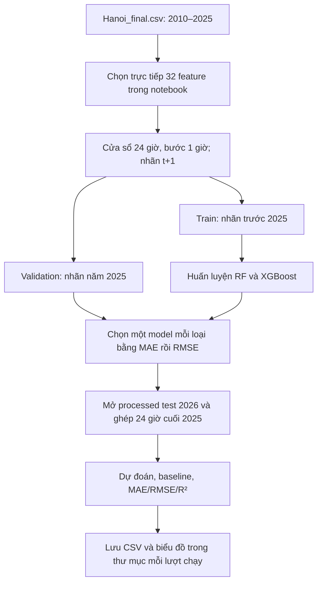

# Mô tả dự án Weather Forecasting — Hà Nội

Ngày cập nhật: **23/10/2026**, múi giờ `Asia/Ho_Chi_Minh` (UTC+7).

Tài liệu mô tả mã nguồn, dữ liệu và kết quả thực tế có trong thư mục dự án tại thời điểm kiểm tra. Trạng thái được đối chiếu từ code, output notebook, CSV kết quả và file trạng thái; không chỉ dựa vào nội dung README.

## 1. Mục tiêu và phạm vi

Dự án dự báo **nhiệt độ không khí ở độ cao 2 m tại Hà Nội sau 1 giờ**, từ các quan sát thời tiết theo giờ đã có ở thời điểm dự báo.

| Thành phần | Mô tả |
|---|---|
| Khu vực | Hà Nội; vĩ độ `21.0285`, kinh độ `105.8542` |
| Nguồn thu thập được cấu hình | Open-Meteo Historical Weather API, bộ dữ liệu ERA5 |
| Độ phân giải | Mỗi dòng tương ứng 1 giờ, giờ địa phương Hà Nội |
| Biến mục tiêu | `temperature_2m`, đơn vị °C |
| Luồng ML chính hiện tại | Random Forest và XGBoost; cửa sổ 24 giờ, trượt 1 giờ, dự báo sau 1 giờ |
| Đầu vào mỗi mẫu ML hiện tại | 32 feature × 24 giờ = **768 giá trị**, được trải phẳng thành một hàng |
| Tập train | Chia theo thời điểm nhãn: trước `01/01/2025` |
| Tập validation | Nhãn trong năm 2025; dùng chọn cấu hình model |
| Tập test | Nhãn từ `01/01/2026 00:00` đến `29/09/2026 23:00` |
| Cách chọn model | Giữ riêng một RF và một XGBoost có MAE validation nhỏ nhất; hòa thì xét RMSE |
| Chỉ số | MAE, RMSE theo °C và R²; đối chiếu baseline persistence |
| Deep Learning | Có định hướng LSTM/GRU và file dependency; chưa có notebook huấn luyện DL trong bản hiện tại |

Persistence dự báo nhiệt độ ở giờ tiếp theo bằng nhiệt độ hiện tại. Ví dụ, để dự báo nhiệt độ lúc `01/01/2026 00:00`, model dùng quan sát từ `31/12/2025 00:00` đến `31/12/2025 23:00`.

## 2. Quy ước nhãn trạng thái

| Nhãn | Ý nghĩa | Điều kiện áp dụng |
|---|---|---|
| **END** | Phase đã hoàn thành trong phạm vi ghi rõ | Có sản phẩm đầu ra hoặc bằng chứng thực thi tương ứng |
| **OPEN** | Phase đã bắt đầu nhưng còn dở dang | Đã có code/kết quả một phần, chưa đạt điều kiện hoàn tất |
| **CHỜ** | Chưa thực hiện trong bản dự án hiện có | Chưa thấy phần triển khai hoặc kết quả tương ứng |

`OPEN` mô tả tiến độ công việc, không khẳng định một tiến trình đang chạy trên máy. `END` không có nghĩa mọi file phụ trợ đều đã được tải về hoặc mọi hướng mở rộng đều hoàn thành.

Hai notebook tiền xử lý đã xóa output và `execution_count`; phase tiền xử lý vẫn được ghi `END` vì có CSV processed, báo cáo lựa chọn feature và SHA-256 khớp dữ liệu hiện tại.

## 3. Các phase và tiến độ hiện tại

| Phase | Công việc | Trạng thái | Bằng chứng / phần còn lại |
|---|---|---|---|
| 00 | Chuẩn bị môi trường và dependency | **END** | Có `requirements.txt`, `requirements-dl.txt`; notebook ML/EDA có kết quả chạy trước đây. Khi chuyển máy vẫn cần cài môi trường lại. |
| 01 | Thu thập raw train và raw test | **END** | Có hai crawler, định danh dữ liệu raw trong Git LFS và báo cáo xử lý. **Bản local hiện chỉ có con trỏ raw**, cần khôi phục trước khi chạy lại từ raw. |
| 02 | Kiểm tra và khám phá dữ liệu | **END** | Có `src/inspect_data.py`; hai notebook EDA có output thống kê/biểu đồ đã lưu. |
| 03 | Làm sạch và tạo feature nhân quả | **END** | Hai CSV processed có dữ liệu đầy đủ, cùng schema 41 cột; hash khớp báo cáo. |
| 04 | Thử nghiệm và chốt feature bằng CV thời gian | **END** | `feature_selection.json` và `feature_experiment_review.md`: chốt `joint_reduced`, 33 feature ML cho luồng thử nghiệm input 1 giờ. |
| 05 | Tạo cửa sổ 24 giờ, chia train/validation và baseline | **END** | Notebook ML đã tạo 131.448 mẫu train, 8.760 mẫu validation; mỗi mẫu 768 cột. |
| 06 | Huấn luyện và chốt hai model trong lượt 82 cấu hình | **END** | Lượt `run_x2dflq_j` đã chốt ngày 22/10/2026: 49 RF + 33 XGBoost; trạng thái lưu là `completed`. Đây là phạm vi đã chốt của lượt này. |
| 07 | Test hai model đã chốt và lập báo cáo | **END** | Có điểm số, dự đoán, thống kê theo tháng, biểu đồ và báo cáo cho 6.528 giờ test 2026. |
| 08 | Mở rộng tìm kiếm và chấm test đủ 219 cấu hình | **OPEN** | `full_grid_219`: có **139/219 điểm validation** và **91/219 điểm test**; chưa hoàn tất toàn bộ dải. |
| 09 | Huấn luyện và đánh giá LSTM/GRU | **CHỜ** | Chưa có file huấn luyện DL hoặc kết quả LSTM/GRU; mới có dependency TensorFlow và danh sách feature dự kiến. |
| 10 | Bộ kiểm thử tự động độc lập | **CHỜ** | Không có thư mục `tests/` trong bản hiện tại. Code có kiểm tra dữ liệu/assertion nhưng chưa thay thế một bộ test độc lập. |
| 11 | Tài liệu tổng hợp dự án và hướng dẫn thứ tự chạy | **END** | File `MO_TA_DU_AN.md` này. |

**Chi tiết phase 08 tại lần kiểm tra ngày 23/10/2026:**

- Validation đã có 49 cấu hình RF và 90 cấu hình XGBoost, tổng 139 cấu hình.
- Test đã có 1 cấu hình RF và 90 cấu hình XGBoost, tổng 91 cấu hình; có 91 file dự đoán `.npz` tương ứng.
- Còn thiếu 80 điểm validation và 128 điểm test để đủ 219 cấu hình mỗi bảng.
- `search_state.json` còn ghi `status = "running"`, PID `35091`, nhóm `XGBoost depth=18, lr=0.05`. Khi kiểm tra danh sách tiến trình, PID này không tồn tại. Vì vậy đây là **lượt đang dở dang cần tiếp tục**, không xác nhận đang train nền.
- Nhãn `END` cho phase 06–07 áp dụng cho lượt chốt 82 cấu hình; không dùng nhãn đó để kết luận lượt 219 cấu hình đã xong.

## 4. Hai luồng thực hiện cần phân biệt

### 4.1. Luồng tiền xử lý và thử nghiệm feature — END

```text
Raw 2010–2025
    → làm sạch, kiểm tra trục thời gian
    → tạo sin/cos thời gian, sin/cos hướng gió, lag/delta/rolling nhiệt độ
    → chia development / holdout 20% cuối
    → CV thời gian 5 fold + thử bỏ từng cột/nhóm cột
    → chốt bộ feature và model bằng CV
    → lưu processed + feature_selection.json
    → chuẩn bị raw test 2026 bằng lịch sử cuối 2025
    → đánh giá holdout và test, lưu báo cáo/model/biểu đồ
```

Luồng này do `src/feature_experiments.py` thực hiện; `clean_raw.ipynb` gọi lại cùng hàm. Mặc định dùng input **một giờ với các lag được tạo tường minh**, không phải cửa sổ 24 giờ của notebook ML hiện tại.

20% cuối 2010–2025 làm holdout, bắt đầu theo giờ nhãn tại `20/10/2022 04:00`. Chọn feature bằng CV trên phần development, rồi mới đánh giá holdout/test. Model dùng đánh giá 2026 trong luồng này được fit lại bằng dữ liệu 2010–2025.

### 4.2. Luồng ML chính bằng cửa sổ 24 giờ — đã có lượt END, mở rộng OPEN



`train_model/ml_models.ipynb` chứa trực tiếp code xử lý, train và test; **không đọc `feature_selection.json` để chọn input**. Notebook dùng 28 biến thời tiết đã xử lý hướng gió và 4 biến thời gian, tổng 32 feature. Các cột lag/delta/rolling trong CSV processed không được chọn vào luồng này.

Model đánh giá test ở luồng chính vẫn chỉ fit trên train trước 2025, không fit lại trên validation 2025. Khi dự báo từng giờ, những quan sát test đã xảy ra được dùng làm lịch sử cho giờ tiếp theo; model không được cập nhật bằng nhãn test.

Script mở rộng `full_grid_219/run_all_configs.py` còn chấm test cho từng cấu hình và lưu mảng dự đoán. Đây là nhánh mở rộng riêng; quy tắc chọn model trong script vẫn dùng validation.

## 5. Cấu trúc thư mục

```text
Weather-Forecasting-work/
├── MO_TA_DU_AN.md                         # Tài liệu tổng hợp này
├── README.md                             # Giới thiệu và lịch sử các luồng
├── requirements.txt                      # Dependency ML, xử lý dữ liệu, notebook
├── requirements-dl.txt                   # Dependency bổ sung cho DL
├── .gitattributes                        # Quy tắc Git LFS cho raw CSV
├── .gitignore                            # Bỏ qua artifact, môi trường, cache
├── crawl_data/
│   ├── crawl_hanoi_enriched_weather.py    # Raw 2010–2025
│   └── crawl_test_set.py                  # Raw 01/01–29/09/2026
├── data/
│   ├── raw/
│   │   ├── Hanoi.csv                     # Hiện là con trỏ Git LFS
│   │   └── test/Hanoi_test_set.csv        # Hiện là con trỏ Git LFS
│   └── processed/
│       ├── Hanoi_final.csv               # 140.232 dòng × 41 cột
│       └── Hanoi_test_final.csv          # 6.528 dòng × 41 cột
├── src/
│   ├── weather_data.py                   # Schema, feature và kiểm tra thời gian
│   ├── inspect_data.py                   # Báo cáo chất lượng raw qua terminal
│   └── feature_experiments.py            # Pipeline chọn feature và đánh giá
├── data_processing/
│   ├── clean_raw.ipynb                   # Làm sạch + gọi pipeline feature
│   ├── prepare_test_set.ipynb            # Tạo lại riêng processed test
│   ├── feature_selection.json            # Feature, cấu hình, điểm số, hash
│   └── feature_experiment_review.md      # Báo cáo thử nghiệm feature
├── eda/
│   ├── data_analyze.ipynb                # Thống kê và kiểm tra dữ liệu
│   └── eda_visualization.ipynb           # Biểu đồ EDA
├── train_model/
│   └── ml_models.ipynb                   # Notebook RF/XGBoost chính
├── docs/
│   └── ml_training.md                    # Hướng dẫn luồng ML theo năm
└── artifacts/ml_sliding_window/
    ├── 20261017_222149_mfeyc2z3/          # Kết quả cũ, có model đã lưu
    ├── 20261017_223841_notebook_5p5kcsof/  # Kết quả notebook cũ, có model đã lưu
    ├── run_pg3egqqk/                     # Lượt so sánh RF/XGBoost trước đó
    ├── run_t0wvsuho/                     # Lượt tìm kiếm dở dang trước đó
    ├── run_x2dflq_j/                     # Lượt 82 cấu hình đã chốt
    └── full_grid_219/                    # Lượt mở rộng 219 cấu hình, còn dở dang
```

`artifacts/` bị `.gitignore` bỏ qua nên các file trong đó có thể không đi kèm khi clone repo. Cây trên phản ánh các thư mục đang có ở bản local này. Cache như `__pycache__/`, `.matplotlib/` và dữ liệu quản lý Git không phải bước nghiệp vụ cần chạy.

## 6. Thứ tự chạy file

Thực hiện các lệnh từ **thư mục gốc dự án**. Các lệnh dưới đây là hướng dẫn; việc tạo tài liệu này không chạy lại crawler hoặc train model.

### 6.1. Bước chuẩn bị môi trường

```bash
python3.12 -m venv .venv
source .venv/bin/activate
python -m pip install -r requirements.txt
```

Notebook có thể mở bằng VS Code hoặc một giao diện Jupyter đã cài. `nbconvert` trong requirements cho phép chạy notebook bằng terminal.

### 6.2. Cách A — chạy ML với processed sẵn có

Đây là đường chạy ngắn nhất với dữ liệu local hiện tại.

1. Cài môi trường theo mục 6.1.
2. Kiểm tra có `data/processed/Hanoi_final.csv` và `data/processed/Hanoi_test_final.csv`.
3. Mở `train_model/ml_models.ipynb`, chạy lần lượt mục 1 đến mục 9 để train/chọn model.
4. Trong **cùng kernel**, chạy tiếp mục 10 đến mục 12 để test và xuất kết quả.
5. Mục 13 chỉ đọc bảng kết quả mở rộng `full_grid_219/all_config_test_metrics.csv`; chạy khi file đó có sẵn và cần xem tiến độ.

Lệnh thực thi toàn bộ notebook:

```bash
jupyter nbconvert --to notebook --execute train_model/ml_models.ipynb --inplace --ExecutePreprocessor.timeout=-1
```

Lệnh này train lại dải tham số trong code: 75 RF và 144 XGBoost. Kết quả tạo một thư mục `run_*` mới, còn output trong notebook được cập nhật tại chỗ. Đây không phải lệnh chỉ hiển thị kết quả đã lưu hoặc tự tiếp tục lượt 82 cấu hình.

Mục 13 đọc một file của lượt mở rộng riêng, không phải file do lượt `run_*` mới tạo ra. Khi bản clone chưa có `full_grid_219`, chỉ chạy mục 1–12 để thực hiện luồng chính; bỏ qua mục 13.

### 6.3. Cách B — tái tạo từ raw

**Điều kiện:** hai file raw phải là CSV thật. Hiện chúng chỉ chứa ba dòng con trỏ Git LFS, không dùng được cho EDA hoặc tiền xử lý.

Nếu có quyền truy cập đối tượng LFS của repository, khôi phục bằng:

```bash
git lfs pull --include="data/raw/Hanoi.csv,data/raw/test/Hanoi_test_set.csv"
```

Hoặc tải lại bằng hai crawler, theo thứ tự:

```bash
python crawl_data/crawl_hanoi_enriched_weather.py
python crawl_data/crawl_test_set.py
```

Sau khi có raw thật:

| Thứ tự | File / lệnh | Bắt buộc? | Kết quả |
|---|---|---|---|
| 1 | `python src/inspect_data.py` | Nên chạy | Kiểm tra chất lượng raw train trước các bước sau |
| 2 | `eda/data_analyze.ipynb` | Khi cần phân tích | Thống kê, tương quan, bảng tổng hợp và outlier |
| 3 | `eda/eda_visualization.ipynb` | Khi cần phân tích | Biểu đồ khám phá raw; chạy độc lập với notebook thống kê |
| 4 | `python -m src.feature_experiments` **hoặc** `data_processing/clean_raw.ipynb` | Chọn một cách | Tạo processed train/test, chọn feature, đánh giá và ghi báo cáo |
| 5 | `data_processing/prepare_test_set.ipynb` | Tùy chọn | Chỉ cần khi muốn tạo lại riêng processed test sau bước 4 |
| 6 | `train_model/ml_models.ipynb`, mục 1–12 | Với luồng ML chính | Train/chọn RF và XGBoost, test 2026, lưu kết quả |
| 7 | Đọc CSV/báo cáo/biểu đồ của lượt vừa chạy | Có | Tổng hợp và diễn giải kết quả |

Thực thi hai notebook EDA bằng terminal, nếu cần:

```bash
jupyter nbconvert --to notebook --execute eda/data_analyze.ipynb --inplace
jupyter nbconvert --to notebook --execute eda/eda_visualization.ipynb --inplace
```

Chọn **một** trong hai cách chạy pipeline feature:

```bash
python -m src.feature_experiments
```

Hoặc:

```bash
jupyter nbconvert --to notebook --execute data_processing/clean_raw.ipynb --inplace --ExecutePreprocessor.timeout=-1
```

`clean_raw.ipynb` không chỉ làm sạch: nó gọi toàn bộ CV, thử bỏ feature, đánh giá holdout/test và ghi các đầu ra của pipeline. Không cần chạy lại lệnh module ngay sau notebook này vì sẽ lặp toàn bộ công việc.

Nếu chỉ tạo lại processed test:

```bash
jupyter nbconvert --to notebook --execute data_processing/prepare_test_set.ipynb --inplace
```

Notebook này cần raw train, raw test, processed train và `feature_selection.json` tương ứng. Nó không tự chọn feature hay train model.

### 6.4. Cách C — tiếp tục lượt mở rộng 219 cấu hình, phase OPEN

File hỗ trợ đang có:

```bash
python artifacts/ml_sliding_window/full_grid_219/run_all_configs.py
```

Script đọc các điểm đã lưu trong chính thư mục `full_grid_219`, huấn luyện lại những model cần thiết để bổ sung điểm test còn thiếu, rồi hoàn tất các bảng tổng hợp. Có điểm validation cũ không có nghĩa trọng số model còn tồn tại; một số cấu hình vẫn phải được train lại.

Đây là script hỗ trợ nằm trong artifact bị Git bỏ qua, không phải entry point được phân phối cùng mọi bản clone. Script phụ thuộc ID và nội dung cell của `ml_models.ipynb`; cần rà lại liên kết cell nếu sửa notebook. Không khởi động thêm một worker khác khi đã có lượt chạy cùng thư mục.

Đổi phase 08 sang `END` khi đủ 219 cấu hình RF/XGBoost trong cả bảng validation và bảng test, các file đầu ra cuối lượt đã ghi thành công, và `search_state.json` chuyển `completed`. Baseline persistence không tính vào 219 cấu hình.

## 7. Mô tả chi tiết từng file mã nguồn và notebook

### 7.1. `crawl_data/crawl_hanoi_enriched_weather.py` — phase 01, END

- **Chức năng:** tải dữ liệu thời tiết theo giờ cho Hà Nội từ `01/01/2010` đến `31/12/2025`.
- **Đầu vào:** tọa độ, khoảng ngày, danh sách 30 biến `WEATHER_COLUMNS` và các đơn vị được cấu hình trong code.
- **Xử lý:** gọi API archive theo từng năm; dùng ERA5, múi giờ Hà Nội, °C, km/h, mm; thử lại tối đa ba lần với một số lỗi mạng/API; thêm thông tin thành phố và tọa độ.
- **Kiểm tra:** schema, dữ liệu thiếu/không hữu hạn, timestamp trùng, tính liên tục từng giờ và phủ đủ khoảng ngày yêu cầu.
- **Đầu ra:** `data/raw/Hanoi.csv`, dự kiến 140.256 dòng, 34 cột nếu đủ toàn kỳ.
- **Hàm chính:** `fetch_archive()` tải và kiểm tra một khoảng; `download_archive()` ghép các năm và ghi file; `crawl_hanoi_enriched_weather()` chạy cấu hình train.
- **Cách ghi:** ghi `.csv.tmp`, chỉ thay CSV đích sau khi tải/kiểm tra thành công; lỗi giữ file cũ và trả exit code thất bại.

### 7.2. `crawl_data/crawl_test_set.py` — phase 01, END

- **Chức năng:** tải raw test từ `01/01/2026` đến `29/09/2026`.
- **Xử lý:** gọi lại `download_archive()` của crawler train để dùng cùng nguồn, tọa độ, schema và đơn vị; không dùng forecast API để điền nhãn test.
- **Đầu ra:** `data/raw/test/Hanoi_test_set.csv`, dự kiến 6.528 dòng, 34 cột.
- **Hàm chính:** `crawl_hanoi_test_set()`; chạy độc lập sau khi cài dependency.

### 7.3. `src/inspect_data.py` — phase 02, END

- **Chức năng:** kiểm tra raw train qua terminal, không sửa dữ liệu.
- **Đầu vào mặc định:** `data/raw/Hanoi.csv`; đường dẫn đặt ở `DATA_FILE`.
- **Nội dung báo cáo:** kích thước, bộ nhớ, tên cột, kiểu dữ liệu, thời gian đầu/cuối, timestamp lỗi/trùng, bước thời gian, missing, dòng trùng, cột hằng, thống kê số, vị trí và nhóm biến khí tượng.
- **Kết thúc:** gọi `validate_hourly_frame()`; trả `True` nếu đạt, `False` nếu lỗi; khi chạy script chuyển thành exit code 0/1.
- **Đầu ra:** nội dung in ra terminal, không tạo CSV processed hoặc model. Muốn kiểm tra raw test cần đổi `DATA_FILE` hoặc gọi hàm `inspect_dataset()` với đường dẫn test.

### 7.4. `src/weather_data.py` — phase 03–05, END

Đây là module dùng chung, không phải script cần chạy riêng trong luồng thông thường.

| Thành phần | Chức năng |
|---|---|
| `WEATHER_COLUMNS` | Danh sách 30 biến raw; dùng đồng bộ crawler và bước kiểm tra |
| `METADATA_COLUMNS` | `time`, `city`, `latitude`, `longitude`; không dùng làm input model |
| `TIME_FEATURES` | Sin/cos chu kỳ giờ và ngày trong năm |
| `HISTORY_FEATURES` | Lag 1/3/24 giờ, delta 1 giờ và rolling mean 3 giờ của nhiệt độ |
| `engineer_forecast_features()` | Tạo feature từ hiện tại/quá khứ; hướng gió thành sin/cos; xử lý năm nhuận; bỏ 24 giờ đầu khi chưa có history |
| Tham số `history` | Dùng 24 giờ nhiệt độ ngay trước dữ liệu mới để giữ đủ giờ đầu test; kiểm tra lịch sử tiếp giáp đúng 1 giờ |
| `validate_hourly_frame()` | Bắt lỗi thiếu cột, ít dòng, timestamp sai/trùng/không liên tục, missing và số không hữu hạn |
| `load_feature_selection()` | Đọc danh sách input ML/DL; kiểm tra target/horizon, cột trùng, metadata và tùy chọn đối chiếu SHA-256 processed |
| `build_forecast_dataset()` | Tạo nhãn tương lai, `label_time`, cửa sổ quá khứ và cột input trải phẳng; trả dataset cùng tên cột nhãn |

Notebook ML hiện tại tự tạo cửa sổ bằng NumPy, không gọi `build_forecast_dataset()`. Hàm này được dùng trong pipeline thử nghiệm feature.

### 7.5. `src/feature_experiments.py` — phase 03–04, END

- **Chức năng:** chạy toàn bộ thử nghiệm feature theo thời gian, ghi dữ liệu processed và đánh giá các lựa chọn đã chốt.
- **Đầu vào:** cả hai raw CSV thật và `ExperimentConfig`.
- **Làm sạch:** đọc CSV, chuyển thời gian/số, xóa dòng trùng hoàn toàn, sắp theo giờ; chỉ forward-fill input tối đa 3 giờ; từ chối thiếu nhiệt độ mục tiêu.
- **Tạo tập feature:** `legacy_weather` → `weather_cyclic_wind` → `weather_time` → `all_augmented`; loại cột hằng trên phần development, dùng `cloud_cover` đại diện nhóm mây.
- **CV:** 5 fold `TimeSeriesSplit`, gap bằng horizon; tối đa `4 × 366 × 24` giờ train mỗi fold. RF mặc định 60 cây/depth 12; XGBoost 200 cây/depth 5.
- **Thử loại biến:** VPD, điểm sương, `is_day`, hai tầng nhiệt độ đất và các nhóm kết hợp. Bootstrap ghép cặp 2.000 lần theo ngày; giới hạn suy giảm tổng thể 1% và theo mùa/giờ 5%; có hiệu chỉnh nhiều so sánh và thử bỏ chung.
- **Chốt:** chọn bộ feature trên CV; chọn họ model có MAE CV nhỏ nhất với bộ đã chốt. Sau đó mới đánh giá holdout và mở raw 2026.
- **Đầu ra:** processed train/test, JSON lựa chọn, báo cáo Markdown, bảng CV/evaluation, dự đoán, model `.joblib` và hai biểu đồ. Một số artifact của lượt cũ không có trong bản local hiện tại.
- **Cách chạy:** `python -m src.feature_experiments` từ gốc dự án; không chạy trực tiếp như một file rời vì có import theo package `src`.

Các hàm quan trọng:

| Hàm / lớp | Công việc |
|---|---|
| `ExperimentConfig` | Gom horizon, holdout, CV, seed, số cây, giới hạn sai số, bootstrap và số luồng |
| `read_clean_weather()` | Đọc, chuẩn hóa, forward-fill có giới hạn và kiểm tra raw |
| `make_model()` | Khởi tạo RF hoặc XGBoost cho thử nghiệm feature |
| `prediction_metrics()` | Tính MAE, RMSE, R² |
| `stratified_metrics()` | Tính điểm theo mùa khí tượng và giờ của nhãn |
| `paired_daily_comparison()` | Ước lượng chênh lệch sai số và confidence bounds bằng bootstrap ngày |
| `safe_to_remove()` / `compare_slices()` | Kiểm tra giới hạn suy giảm tổng thể và từng mùa/giờ |
| `feature_sets_for_experiment()` | Tạo các nhóm feature và danh sách thử bỏ biến |
| `run_feature_experiments()` | Điều phối toàn bộ pipeline, chốt và lưu kết quả |
| `write_experiment_review()` | Sinh `feature_experiment_review.md` từ kết quả |
| `plot_experiment_results()` | Vẽ so sánh nhóm feature và sai số theo mùa/giờ |

### 7.6. `data_processing/clean_raw.ipynb` — phase 03–04, END

- **Chức năng:** trình bày tương tác quy trình làm sạch và chạy thử nghiệm feature.
- **Thứ tự nội bộ:** import/cấu hình → đọc raw → chuẩn hóa thời gian/xóa trùng → ép kiểu → kiểm tra/điền thiếu có giới hạn → kiểm tra giờ → xem trước feature → gọi `run_feature_experiments()` → đọc lại kết quả đã lưu.
- **Đầu vào:** raw train; pipeline được gọi còn cần raw test 2026.
- **Đầu ra:** giống module `src.feature_experiments`, kèm bảng hiển thị trong notebook.
- **Quan hệ:** là cách chạy thay thế lệnh module, không phải một bước phải chạy thêm sau lệnh module.

### 7.7. `data_processing/prepare_test_set.ipynb` — phase 03, END

- **Chức năng:** tạo lại riêng processed test với schema và thứ tự cột giống processed train.
- **Đầu vào:** raw test, raw train, `Hanoi_final.csv`, `feature_selection.json`.
- **Xử lý:** làm sạch test → kiểm tra hash processed train và target/horizon → kiểm tra test nối tiếp train đúng 1 giờ → lấy 24 giờ cuối raw train để tạo feature test → bỏ cột thừa, báo lỗi nếu thiếu cột → kiểm tra chất lượng.
- **Đầu ra:** `data/processed/Hanoi_test_final.csv`; giữ đủ 6.528 giờ khi raw hiện tại đầy đủ.
- **Không có bước train hoặc lựa chọn lại feature.** Chạy sau khi đã có processed train và JSON tương ứng.

### 7.8. `eda/data_analyze.ipynb` — phase 02, END

- **Chức năng:** phân tích thống kê raw train để hiểu chất lượng và cấu trúc dữ liệu.
- **Đầu vào:** `data/raw/Hanoi.csv` thật.
- **Nội dung:** kiểm tra missing/kiểu dữ liệu/số giá trị khác nhau, timestamp và bước giờ; thống kê mô tả; tổng hợp theo giờ và tháng; tương quan với nhiệt độ; phát hiện outlier theo IQR.
- **Đầu ra:** các bảng trong notebook; không thay đổi raw, không tạo processed, không train.
- **Thứ tự:** chạy sau khi có raw; độc lập với notebook biểu đồ.

### 7.9. `eda/eda_visualization.ipynb` — phase 02, END

- **Chức năng:** trực quan hóa dữ liệu raw Hà Nội.
- **Biểu đồ:** nhiệt độ trung bình ngày theo thời gian; phân phối các biến chính; chu kỳ nhiệt độ theo giờ/tháng; tổng mưa theo tháng trong dữ liệu; heatmap tương quan; quan hệ nhiệt độ với độ ẩm, mưa và mây.
- **Đầu vào:** raw train thật; bước vẽ scatter lấy mẫu tối đa 8.000 dòng với seed 42.
- **Đầu ra:** biểu đồ nhúng trong notebook; không xuất dataset hoặc model.

### 7.10. `train_model/ml_models.ipynb` — phase 05–08

Đây là **file chạy chính để huấn luyện và đánh giá RF/XGBoost hiện tại**. Lượt chốt đã `END`; mục theo dõi mở rộng 219 cấu hình còn `OPEN`.

| Mục trong notebook | Công việc | Đầu ra / biến quan trọng |
|---|---|---|
| 1 | Import pandas, NumPy, matplotlib, RF, XGBoost, metric và công cụ chia tập | Các thư viện |
| 2 | Cấu hình đường dẫn, cửa sổ 24, horizon 1, seed 42, `N_JOBS = 4`; tạo thư mục lượt chạy mới | `DATA_PATH`, `TEST_DATA_PATH`, `RUN_DIR` |
| 3 | Đọc processed 2010–2025 và xem dữ liệu | `data` |
| 4 | Khai báo 28 biến thời tiết và 4 biến thời gian | `INPUT_FEATURES`, `input_columns` |
| 5 | Tạo cửa sổ bằng `sliding_window_view()`, đảo thứ tự để giờ mới nhất đứng trước, trải phẳng; chia theo nhãn bằng `train_test_split(..., shuffle=False)` | `X_train`, `X_valid`, `y_train`, `y_valid` |
| 6 | Khai báo hàm metric, tạo baseline và khung dự đoán validation | `regression_metrics()`, `baseline_metrics` |
| 7 | Tạo 75 tổ hợp RF, fit train, chấm validation, giữ RF tốt nhất | `rf_scores`, `best_rf_model` |
| 8 | Tạo 144 tổ hợp XGBoost, fit/chấm tương tự, giữ XGBoost tốt nhất | `xgb_scores`, `best_xgb_model` |
| 9 | Tổng hợp điểm validation và chốt riêng một model mỗi loại | `selected_models`, `validation_metrics` |
| 10 | Đọc processed test; ghép 24 giờ cuối 2025 và tạo cửa sổ tương ứng | `X_test`, `y_test` |
| 11 | Dự đoán hai model và persistence; lưu điểm và dự đoán validation/test | Bốn CSV metrics/predictions |
| 12 | Tính điểm từng tháng; vẽ tuần test đầu và MAE theo tháng; liệt kê file | `test_metrics_by_month.csv`, `test_2026.png` |
| 13 | Đọc bảng test đã lưu của lượt mở rộng 219 cấu hình | Bảng tiến độ, không train thêm |

Phạm vi tham số trong code:

| Model | `max_depth` | `n_estimators` | `learning_rate` | Số tổ hợp |
|---|---|---|---|---:|
| RF | 1–20, 24, 28, 32, 36, 40 | 80, 160, 300 | Không dùng | 75 |
| XGBoost | 1–12, 14, 16, 18, 20 | 200, 300, 600 | 0,03; 0,05; 0,1 | 144 |

RF còn dùng `min_samples_leaf = 2`, `max_features = "sqrt"`. XGBoost dùng objective hồi quy bình phương, `tree_method = "hist"`, `subsample = 0.9`, `colsample_bytree = 0.9`.

Notebook dùng trực tiếp feature của CSV processed, không scale và không điền missing. Cần giữ trục thời gian/schema sạch từ bước chuẩn bị dữ liệu. Code hiện căn nhãn cho **horizon 1 giờ**; thay riêng `HORIZON_HOURS` không tự thay các phép cắt mảng.

Hai model chỉ nằm trong `selected_models` của kernel; notebook hiện tại không ghi model `.joblib`. Mở lại notebook có output không khôi phục đối tượng model trong RAM.

## 8. Mô tả từng file dữ liệu, cấu hình và tài liệu

| File | Chức năng và nội dung | Cách dùng / tình trạng |
|---|---|---|
| `data/raw/Hanoi.csv` | Raw 2010–2025; schema gồm thời gian, 30 biến thời tiết, thành phố và tọa độ | Hiện **133 byte**, là con trỏ Git LFS; khôi phục hoặc crawl trước khi đọc raw |
| `data/raw/test/Hanoi_test_set.csv` | Raw test 01/01–29/09/2026, schema đồng nhất crawler train | Hiện **132 byte**, là con trỏ Git LFS |
| `data/processed/Hanoi_final.csv` | Dữ liệu đã làm sạch/tạo feature; **140.232 dòng × 41 cột**, từ `02/01/2010 00:00` đến `31/12/2025 23:00` | Input chính của notebook ML; đã bỏ 24 giờ đầu thiếu lịch sử |
| `data/processed/Hanoi_test_final.csv` | Dữ liệu test đã xử lý; **6.528 dòng × 41 cột**, từ `01/01/2026 00:00` đến `29/09/2026 23:00` | Input test chính; giữ giờ đầu năm nhờ lịch sử cuối 2025 |
| `data_processing/feature_selection.json` | Lưu target/horizon, thứ tự feature ML/DL, các bộ thử nghiệm, cấu hình, CV, drop-column, bootstrap, holdout/test, điểm theo mùa/giờ và SHA-256 | Sản phẩm của thử nghiệm feature; không phải danh sách input mà notebook ML hiện tại tự đọc |
| `data_processing/feature_experiment_review.md` | Báo cáo giải thích phương pháp chọn feature, bảng sai số và kết quả thử bỏ cột | Kết quả luồng input 1 giờ; một số đường dẫn artifact trong báo cáo không có ở bản local này |
| `docs/ml_training.md` | Hướng dẫn cửa sổ trượt, chia theo năm, tìm tham số, chọn model và test; ghi kết quả các lượt 17/10 và 22/10 | Đọc để hiểu notebook; không cần thực thi |
| `README.md` | Giới thiệu dự án, cấu trúc, cách cài/chạy, luồng feature cũ và luồng ML mới | Có thông tin lịch sử; cần phân biệt từng thử nghiệm khi đọc |
| `MO_TA_DU_AN.md` | Tổng hợp chức năng từng file, phụ thuộc, thứ tự chạy, kết quả và phase | Cập nhật cùng trạng thái thực tế khi tiếp tục dự án |
| `requirements.txt` | Ghim dependency: requests, pandas, NumPy, scikit-learn, XGBoost, joblib, matplotlib, seaborn, SciPy, ipykernel, nbconvert, nbclient | Cài cho crawler, xử lý, EDA và ML; môi trường được tài liệu dự án hướng tới là Python 3.12 |
| `requirements-dl.txt` | Bao gồm `requirements.txt`, bổ sung `tensorflow==2.21.0` | Chuẩn bị môi trường DL; không phải code huấn luyện LSTM/GRU |
| `.gitattributes` | Khai báo `data/raw/*.csv` và `data/raw/test/*.csv` dùng Git LFS | Giải thích vì sao raw trong bản tải có thể chỉ là con trỏ |
| `.gitignore` | Bỏ qua cache Python/notebook, môi trường ảo, log, `artifacts/` và file hệ điều hành | Artifact có trên máy không đồng nghĩa đã được commit vào repository |

Processed lưu hợp của 33 feature ML đã chọn và 32 feature DL dự kiến, cộng 4 cột metadata, tổng 41 cột. Hai danh sách feature giao nhau nên không cộng thẳng thành 65 feature. Nhiệt độ tương lai không lưu sẵn trong CSV; nhãn được tạo khi chuẩn bị dataset train.

Kết quả chọn feature cũ bỏ `dew_point_2m`, `vapour_pressure_deficit`, `is_day`, `soil_temperature_7_to_28cm` khỏi bộ ML 33 feature. Các cột này vẫn tồn tại trong processed để phục vụ bộ 32 feature weather + time; notebook ML cửa sổ 24 giờ hiện tại cũng chọn bộ 32 này.

## 9. Mô tả các file kết quả và script hỗ trợ trong artifacts

Các tên file lặp lại giữa những lượt chạy được giải thích chung dưới đây. Mỗi thư mục lượt chạy là một bộ kết quả riêng; không ghép tùy ý metric của lượt này với dự đoán hoặc model của lượt khác.

### 9.1. Ý nghĩa từng loại file đầu ra

| Tên file | Chức năng |
|---|---|
| `validation_metrics.csv` | MAE/RMSE/R² validation, tham số, thời gian fit và cờ model được chọn nếu lượt đó có lưu |
| `validation_predictions.csv` | Dự đoán trên validation kèm thời gian, nhãn thật và persistence; phạm vi cột model tùy phiên bản lượt chạy |
| `test_metrics.csv` | Điểm tổng thể test của model đã chốt và baseline |
| `test_predictions.csv` | Nhiệt độ thật/dự đoán, giờ đầu cửa sổ hoặc giờ dự báo, giờ nhãn và baseline tùy lượt |
| `test_metrics_by_month.csv` | Sai số từng model theo tháng của nhãn test |
| `test_2026.png` | So sánh dự đoán với quan sát ở tuần đầu test và MAE từng tháng |
| `best_model.joblib` | Model/bundle đã lưu trong hai lượt 17/10; dùng với đúng feature và cấu hình của lượt đó |
| `selection.json` | Ghi cấu hình, ứng viên, cách chọn, thông tin split và feature của các lượt 17/10 |
| `evaluation.json` | Metadata đánh giá test, hash dữ liệu/model và chỉ số của các lượt 17/10 |
| `data_splits.csv` | Số mẫu, số cột input và biên thời gian từng tập ở các lượt 17/10 |
| `history_context.csv` | 24 giờ cuối 2025 với feature cần thiết để tạo cửa sổ test đầu năm, ở các lượt 17/10 |
| `validation_search_progress.csv` | Điểm validation của các cấu hình đã hoàn thành; dùng theo dõi/tiếp tục tìm kiếm |
| `search_state.json` | Trạng thái worker, PID, nhóm đang xử lý, số cấu hình và ứng viên tốt nhất; có thể còn trạng thái cũ sau khi tiến trình dừng |
| `execution_notes.txt` | Ghi chú cách thực thi, tối ưu huấn luyện, phạm vi đã chạy và cách diễn giải thời gian fit |
| `selected_models_comparison.csv` | Bảng so sánh validation/test của hai model chốt ở lượt 82 cấu hình |
| `selected_models_report.md` | Báo cáo đọc trực tiếp cho lượt chốt 22/10, gồm cấu hình, metric và liên kết đầu ra |
| `resume_search.log` | Log lượt tìm kiếm tiếp tục; lượt cũ kết thúc bằng ngắt chạy, cần đọc cùng log chốt sau đó |
| `finalize_selected.log` | Log bước chốt và đánh giá model từ các cấu hình đã hoàn thành |
| `resume_search.pid`, `worker.pid` | PID được ghi khi khởi động worker; file còn tồn tại không chứng minh tiến trình còn chạy |
| `training.log` | Log tiến độ của lượt mở rộng, tên nhóm, số cây và metric |
| `all_config_test_metrics.csv` | Điểm test của từng cấu hình đã chấm trong lượt mở rộng; chỉ đầy đủ khi đủ 219 cấu hình, baseline có thể được thêm ở bước cuối |
| `test_targets.csv` | 6.528 timestamp nhãn test và nhiệt độ thật, dùng ghép với các mảng dự đoán |
| `test_prediction_arrays/<tên_model>.npz` | Một mảng `prediction` cho từng cấu hình đã test; tên file mã hóa họ model, depth, số cây và learning rate nếu có |
| `cache_benchmark.json` | Thời gian đo cấu hình cache histogram XGBoost trong phép thử hiệu năng nhỏ; không phải bảng tuning model |
| `.matplotlib/fontlist-v390.json` | Cache font do matplotlib tạo; không chứa kết quả dự báo và không phải file cần chạy |

### 9.2. Các thư mục lượt chạy

| Thư mục dưới `artifacts/ml_sliding_window/` | Nội dung và trạng thái |
|---|---|
| `20261017_222149_mfeyc2z3/` | **END:** lượt cũ chọn một model chung, XGBoost depth 6; có model, metadata, split, history và kết quả test |
| `20261017_223841_notebook_5p5kcsof/` | **END:** lượt notebook cũ gọi thư viện trực tiếp; cùng kết quả XGBoost depth 6, có bundle model và metadata |
| `run_pg3egqqk/` | **END:** lượt so sánh trước đó, chọn RF depth 20 và XGBoost depth 6; có sáu file metrics/predictions/biểu đồ của luồng notebook |
| `run_t0wvsuho/` | **OPEN:** chỉ có tiến độ 17 cấu hình RF; chưa có bộ đầu ra chốt/test, không dùng làm kết quả cuối |
| `run_x2dflq_j/` | **END trong phạm vi 82 cấu hình:** có báo cáo, điểm validation, hai model được chốt và kết quả test; không lưu trọng số model |
| `full_grid_219/` | **OPEN:** lượt mở rộng đủ 219 cấu hình; hiện có điểm validation/test một phần, script hỗ trợ và mảng dự đoán từng cấu hình |

### 9.3. `run_x2dflq_j/resume_search.py`

- **Chức năng:** tiếp tục tìm kiếm từ điểm validation đã lưu, hoặc dùng `--finalize-current` để chốt từ các cấu hình đã hoàn thành.
- **Cách làm:** đọc notebook theo ID cell, lấy code chuẩn bị dữ liệu/tham số; RF dùng `warm_start` theo số cây, XGBoost huấn luyện tới số vòng lớn rồi chấm các prefix 200/300/600 vòng.
- **Đầu ra:** cập nhật tiến độ, trạng thái, điểm số; ở bước chốt kiểm tra lại điểm validation của hai model và chạy các cell đánh giá/biểu đồ.
- **Phạm vi:** script hỗ trợ cho lượt 82 cấu hình; không tự có mặt ở mọi bản clone và không phải bước bắt buộc của luồng chính.

### 9.4. `full_grid_219/run_all_configs.py`

- **Chức năng:** tiếp tục validation và bổ sung test cho toàn bộ 75 RF + 144 XGBoost.
- **Đầu vào:** notebook hiện tại, processed train/test, các bảng tiến độ và điểm test đã có trong `full_grid_219`.
- **Cách làm:** đọc danh sách cấu hình đã có; chạy nhóm XGBoost rồi RF; tái sử dụng prefix cây khi phù hợp; lưu điểm và mảng dự đoán sau các cấu hình hoàn tất.
- **Chọn model:** luôn so sánh MAE/RMSE validation; điểm test từng cấu hình là bảng đánh giá mở rộng.
- **Bước cuối:** đảm bảo đủ 75 RF, 144 XGBoost và 219 điểm test; tái tạo/kiểm tra model thắng bằng train trước 2025; xuất các bảng cuối, baseline và biểu đồ; cập nhật output notebook và trạng thái hoàn tất.
- **Lưu trữ:** không lưu trọng số model; lưu dự đoán `.npz`. Phụ thuộc ID cell nên cần đồng bộ khi sửa notebook.

### 9.5. `full_grid_219/cache_benchmark.py`

- **Chức năng:** kiểm tra tác động hiệu năng của `max_cached_hist_node = 128` so với `512`.
- **Cách làm:** lấy code tạo feature/window từ notebook; train XGBoost depth 12 với 12 cây trên dữ liệu train; đo thời gian và assert dự đoán validation khớp trong sai số cho phép.
- **Đầu ra:** `cache_benchmark.json` lưu thời gian hai cấu hình. Kết quả đã lưu khoảng 17,31 giây và 13,15 giây; đây chỉ là phép đo cấu hình nhỏ đó, không phải cam kết tốc độ toàn grid.
- **Thứ tự:** công cụ phụ trợ tùy chọn, không cần chạy để tái tạo luồng ML chính.

### 9.6. Các đầu ra của pipeline feature hiện chưa có trong bản local

`src/feature_experiments.py` có code tạo các file sau khi chạy thành công, nhưng thư mục `artifacts/feature_experiments/` và `artifacts/ml/` hiện không có:

| Đường dẫn đầu ra | Chức năng |
|---|---|
| `artifacts/feature_experiments/cv_fold_scores.csv` | Điểm từng fold, từng bộ feature và từng model |
| `artifacts/feature_experiments/cv_summary.csv` | Trung bình/độ lệch chuẩn metric CV để so sánh nhóm feature |
| `artifacts/feature_experiments/cv_predictions.csv` | Dự đoán ngoài fold phục vụ so sánh ghép cặp |
| `artifacts/feature_experiments/drop_column_importance.csv` | Kết quả thử bỏ biến, confidence bounds và quyết định |
| `artifacts/feature_experiments/evaluation_scores.csv` | Điểm holdout và test 2026 sau khi chốt |
| `artifacts/feature_experiments/metrics_by_season_hour.csv` | Điểm và số mẫu theo mùa/giờ |
| `artifacts/feature_experiments/evaluation_predictions.csv` | Nhãn thật và dự đoán theo từng tập/model/bộ feature |
| `artifacts/feature_experiments/selected_models_refit_2026.joblib` | Model của bộ feature đã chốt, fit trên 2010–2025 để đánh giá 2026 |
| `artifacts/feature_experiments/feature_comparison.png` | Biểu đồ so sánh nhóm feature |
| `artifacts/feature_experiments/errors_by_season_hour.png` | Biểu đồ sai số theo mùa/giờ |
| `artifacts/ml/best_ml_feature_experiment_temperature_2m_<timestamp>.joblib` | Bundle model được chọn bằng CV, fit trên development trước holdout |

`feature_selection.json` cũ ghi đường dẫn model dưới `train_model/artifacts/ml/...`; file đó hiện cũng không tồn tại. Code hiện tại ghi model mới vào `artifacts/ml/` ở gốc dự án. Muốn dùng model feature cũ phải khôi phục đúng artifact hoặc chạy lại pipeline, không chỉ đổi tên đường dẫn.

## 10. Kết quả đã xác nhận

### 10.1. Lượt chốt 82 cấu hình ngày 22/10/2026 — END

Nguồn: [báo cáo hai model](artifacts/ml_sliding_window/run_x2dflq_j/selected_models_report.md), [validation](artifacts/ml_sliding_window/run_x2dflq_j/validation_metrics.csv) và [test](artifacts/ml_sliding_window/run_x2dflq_j/test_metrics.csv).

| Model | Cấu hình | MAE validation (°C) | MAE test (°C) | RMSE test (°C) | R² test |
|---|---|---:|---:|---:|---:|
| Random Forest | Depth 16, 300 cây | 0,3992 | 0,4639 | 0,6544 | 0,9851 |
| XGBoost | Depth 8, 600 cây, learning rate 0,03 | 0,2675 | 0,3690 | 0,5794 | 0,9883 |
| Persistence | Nhiệt độ giờ hiện tại | 0,5570 | 0,5841 | 0,9396 | 0,9692 |

Đây là hai model được chọn trong **82 cấu hình đã hoàn tất của lượt chốt**, không phải tuyên bố tốt nhất sau khi chạy đủ 219 cấu hình. Kết quả của lượt mở rộng cần được tổng hợp riêng khi phase 08 hoàn tất.

### 10.2. Thử nghiệm feature cũ — END

`feature_selection.json` ghi nhận `joint_reduced` với 33 feature, chọn XGBoost bằng CV; MAE test 2026 khoảng **0,3887°C**, RMSE **0,5985°C**. Model được fit lại trên 2010–2025 để đánh giá test.

Không diễn giải chênh lệch giữa 0,3887°C và 0,3690°C như tác động riêng của một thay đổi: hai lượt khác input, cách chia/chọn model, cấu hình và phạm vi dữ liệu dùng fit.

## 11. Điều kiện dữ liệu và các điểm cần nhớ khi tiếp tục

1. **Raw hiện là con trỏ Git LFS.** Các bước cần raw phải chờ khôi phục; luồng ML dùng processed có thể chạy với dữ liệu sẵn có.
2. **Processed phải giữ đúng thứ tự cột, trục thời gian và feature.** Hai file hiện có 41 cột cùng schema; hash khớp `processed_sha256` và `external_processed_sha256` trong JSON.
3. **Không đổi thẳng đường dẫn notebook ML sang raw.** Raw chưa có các cột sin/cos mà `INPUT_FEATURES` yêu cầu; cần tạo feature tương ứng trước.
4. **Giữ horizon 1 giờ với code hiện tại.** Muốn đổi horizon phải sửa và kiểm tra cả cách lấy nhãn, cửa sổ và thời điểm split.
5. **Các số lượng feature thuộc từng luồng khác nhau.** 33 feature là bộ ML của thử nghiệm feature input 1 giờ; 32 feature là bộ hiện dùng trong cửa sổ 24 giờ; 41 là số cột lưu trong CSV processed, gồm metadata và hợp các input.
6. **Test dùng để báo cáo.** Không chọn lại tham số từ bảng test, kể cả khi mở bảng điểm của mọi cấu hình. Test 2026 đã được xem qua nhiều lượt nên không còn là tập hoàn toàn chưa từng quan sát.
7. **Bản local chưa có `tests/` hoặc notebook DL.** Các hướng dẫn cũ nhắc đến chúng không chứng minh phần triển khai đang tồn tại. `prepare_final.ipynb` và `evaluate_2026_test_set.ipynb` cũng không có trong bản hiện tại; không đưa chúng vào thứ tự chạy.
8. **ERA5 là dữ liệu tái phân tích.** Kết quả hiện là backtest theo giả định đã có các quan sát đầu vào ở thời điểm dự báo; muốn triển khai thực tế cần kiểm tra nguồn và thời gian có dữ liệu realtime.
9. **Không dùng lại model của lượt khác chỉ vì cùng dự báo nhiệt độ.** Cần khớp feature, thứ tự input, cửa sổ và dữ liệu xử lý. Hai file `best_model.joblib` ngày 17/10 không phải hai model của lượt chốt ngày 22/10.

## 12. Công việc tiếp theo và cách cập nhật trạng thái

| Hạng mục | Trạng thái hiện tại | Điều kiện chuyển sang END |
|---|---|---|
| Hoàn thành lượt mở rộng 219 cấu hình | **OPEN** | Đủ điểm validation/test cho 219 cấu hình, có kết quả cuối và trạng thái worker `completed` |
| Xử lý lượt cũ `run_t0wvsuho` | **OPEN** | Quyết định tiếp tục và hoàn tất hoặc ghi rõ đóng lượt cũ; hiện chỉ có 17 điểm RF |
| LSTM/GRU | **CHỜ** | Có file huấn luyện, cách chia tập/scaler rõ ràng, kết quả validation/test và artifact tương ứng |
| Kiểm thử tự động độc lập | **CHỜ** | Có bộ test thực tế, kiểm tra dữ liệu/cửa sổ/nhãn/biên split/chống dùng tương lai, kèm kết quả chạy |

Khi cập nhật tài liệu: ghi ngày kiểm tra mới; đối chiếu file thực tế trước khi đổi nhãn; phân biệt một lượt chạy đã chốt với một phase mở rộng; chỉ gán `END` khi đạt đúng điều kiện hoàn thành đã mô tả. Các file CSV sinh hàng loạt theo cấu hình được quản lý theo mẫu tên ở mục 9, thay vì liệt kê lại toàn bộ tên model trong tài liệu.
